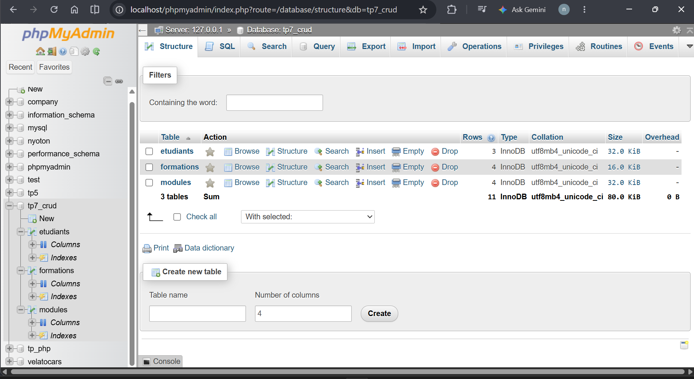
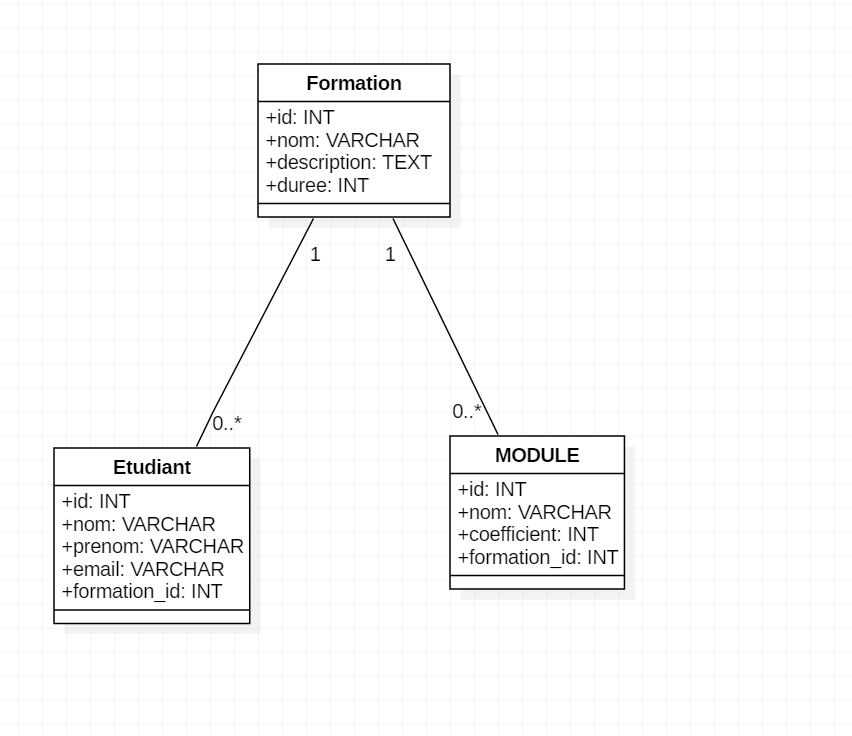
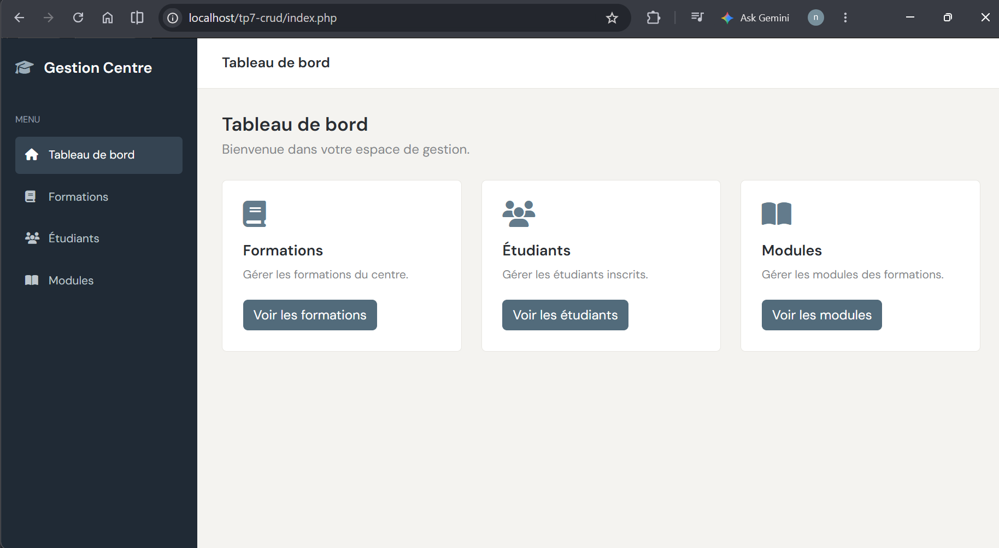
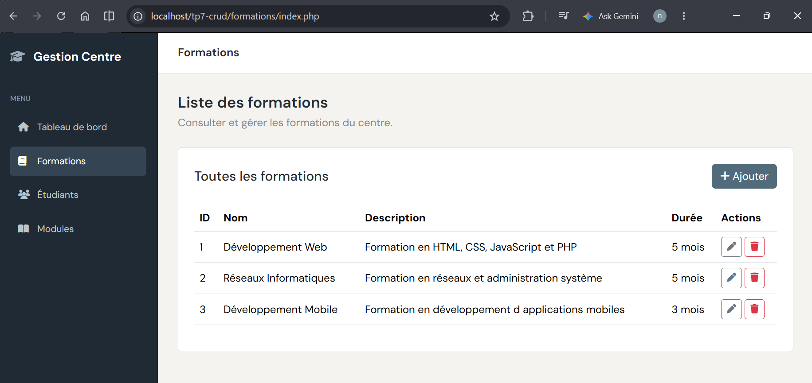
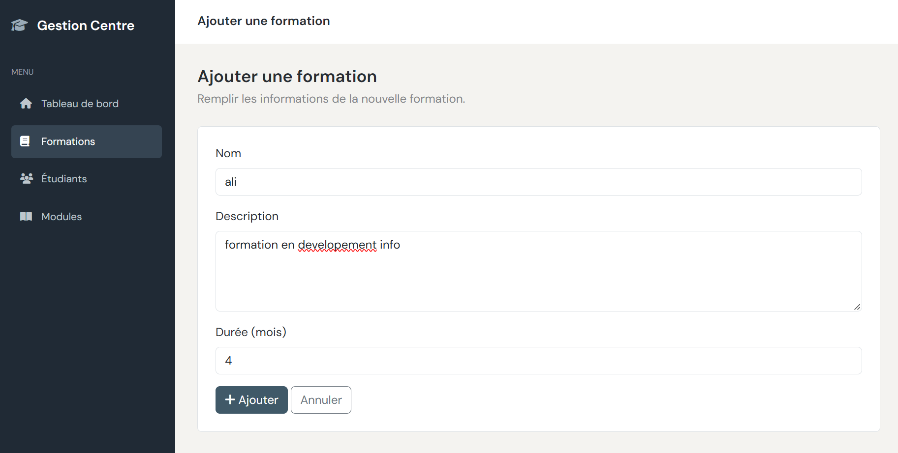
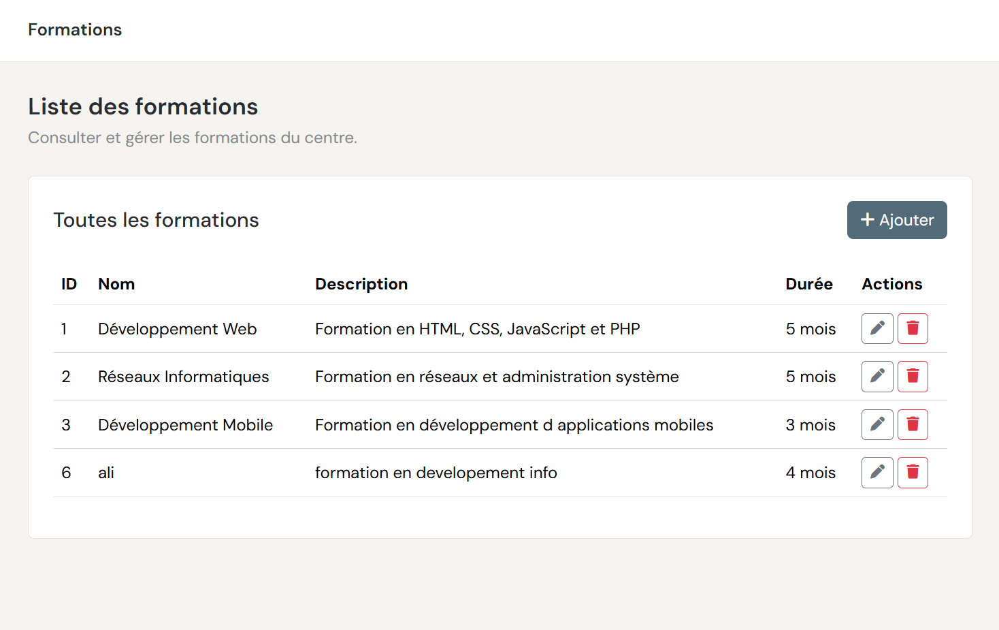
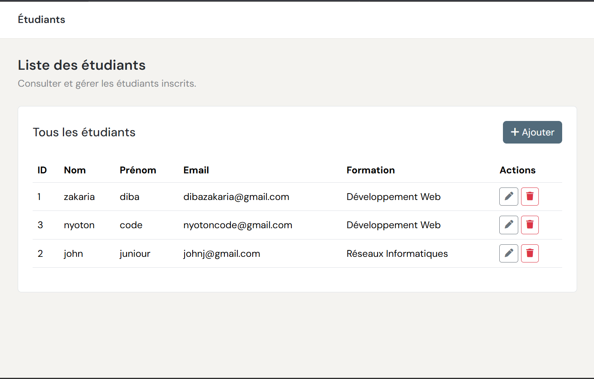
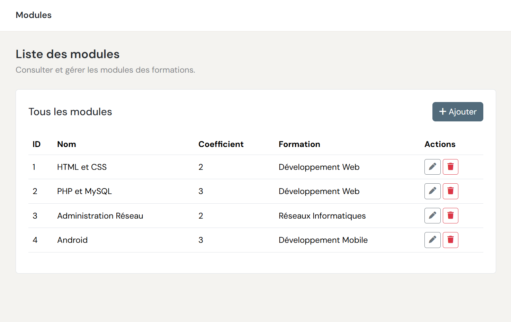

# Gestion d'un Centre de Formation

<p align="center">
  Application web de gestion des formations, des étudiants et des modules réalisée avec PHP et MySQL
</p>

---

## Table des matières

- [Présentation du projet](#présentation-du-projet)
- [Technologies utilisées](#technologies-utilisées)
- [Structure du projet](#structure-du-projet)
- [Base de données](#base-de-données)
- [Diagramme de classes](#diagramme-de-classes)
- [Fonctionnalités](#fonctionnalités)
- [Captures d'écran](#captures-décran)
- [Conclusion](#conclusion)

---

## Présentation du projet


L'application permet de gérer trois éléments principaux :

- **Formations :** création, consultation, modification et suppression des formations.
- **Étudiants :** gestion des étudiants et association de chaque étudiant à une formation.
- **Modules :** gestion des modules et association de chaque module à une formation.


## Technologies utilisées

* [](https://www.php.net/)
* [](https://www.mysql.com/)
* [](https://getbootstrap.com/)
* [](https://developer.mozilla.org/en-US/docs/Web/HTML)
* [](https://developer.mozilla.org/en-US/docs/Web/CSS)
* [](https://fontawesome.com/)


## Structure du projet

Le projet est organisé en plusieurs dossiers  : 

```text
tp7-crud/
│
├── index.php
│
├── database/
│   └── connexion.php
│
├── includes/
│   └── header.php
|   └── footer.php
│
├── assets/
│   └── css/
│       └── style.css
│
├── formations/
│   ├── index.php
│   ├── create.php
│   ├── edit.php
│   └── delete.php
│
├── etudiants/
│   ├── index.php
│   ├── create.php
│   ├── edit.php
│   └── delete.php
│
├── modules/
│   ├── index.php
│   ├── create.php
│   ├── edit.php
│   └── delete.php
│
├── images/
│
└── README.md
```


## Base de données

La base de données utilisée dans ce projet s'appelle `tp7_crud`.

Elle contient trois tables :

| Table | Description |
|---|---|
| `formations` | Informations sur les formations |
| `etudiants` | Informations sur les étudiants |
| `modules` | Informations sur les modules |

### Structure des tables

**Table `formations`**

| Champ | Type | Description |
|---|---|---|
| id | INT | Clé primaire |
| nom | VARCHAR(100) | Nom de la formation |
| description | TEXT | Description de la formation |
| duree | INT | Durée de la formation |

**Table `etudiants`**

| Champ | Type | Description |
|---|---|---|
| id | INT | Clé primaire |
| nom | VARCHAR(100) | Nom de l'étudiant |
| prenom | VARCHAR(100) | Prénom de l'étudiant |
| email | VARCHAR(150) | Adresse email |
| formation_id | INT | Clé étrangère vers formations |

**Table `modules`**

| Champ | Type | Description |
|---|---|---|
| id | INT | Clé primaire |
| nom | VARCHAR(100) | Nom du module |
| coefficient | INT | Coefficient du module |
| formation_id | INT | Clé étrangère vers formations |

### Relations entre les tables

La base de données contient deux relations :

- Une formation peut être associée à plusieurs étudiants.
- Une formation peut contenir plusieurs modules.

Chaque étudiant et chaque module est associé à une seule formation grâce au champ `formation_id`.

### Aperçu de la base de données




## Diagramme de classes



Le diagramme représente les trois entités principales du projet : `Formation`, `Etudiant` et `Module`.

La classe `Formation` est liée aux classes `Etudiant` et `Module`. Les multiplicités représentent le fait qu'une formation peut avoir plusieurs étudiants et plusieurs modules.

## Fonctionnalités

L'application propose les fonctionnalités suivantes :

- Affichage des formations, étudiants et modules.
- Ajout de nouvelles formations.
- Modification des informations .
- Suppression des enregistrements.
- Association des étudiants à une formation.
- Association des modules à une formation.
- Affichage du nom de la formation correspondante dans les listes des étudiants et des modules.

Les opérations de gestion sont réalisées à l'aide de PHP et PDO, avec des requêtes SQL permettant d'interagir avec la base de données.

## Captures d'écran

### Tableau de bord



Le tableau de bord constitue la page principale de l'application. Il permet d'accéder aux différentes parties de gestion.

### Gestion des formations

**Liste des formations**



Cette page affiche les formations enregistrées dans la base de données ainsi que les actions disponibles.

**Ajout d'une formation**



Ce formulaire permet de saisir les informations nécessaires pour ajouter une nouvelle formation.

**Résultat de l'ajout**



Après validation du formulaire, la nouvelle formation apparaît dans la liste.

**Modification et suppression**


Cette capture présente les actions permettant de modifier ou de supprimer une formation.

### Gestion des étudiants



La liste affiche les étudiants enregistrés ainsi que le nom de la formation à laquelle chacun est associé.

### Gestion des modules



Cette page présente les modules enregistrés, leurs coefficients et les formations correspondantes.

## Conclusion

Ce projet nous a permis de mettre en pratique les notions de PHP, PDO et MySQL à travers une application de gestion utilisant les opérations CRUD.

